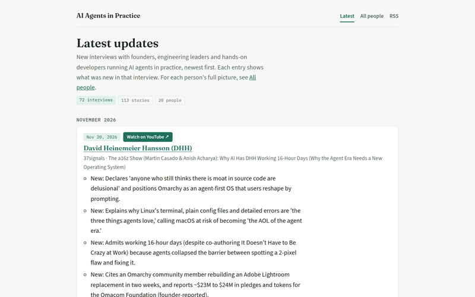
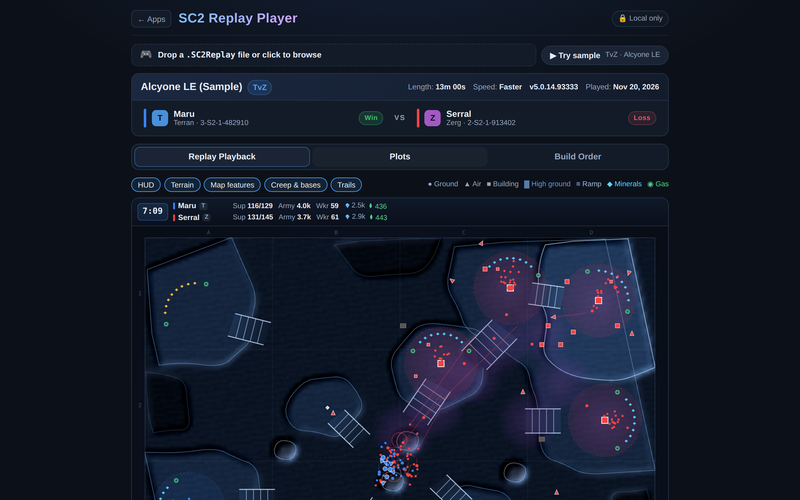
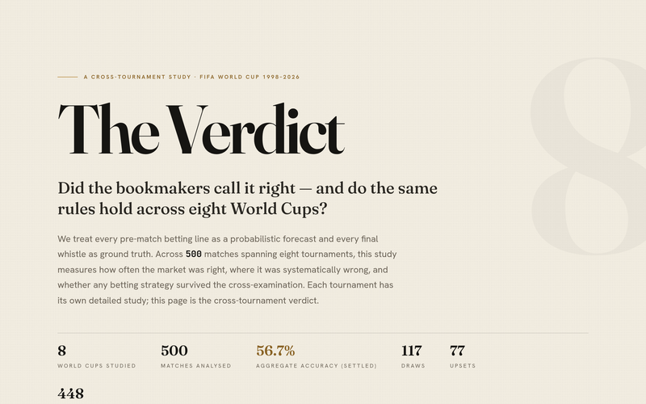
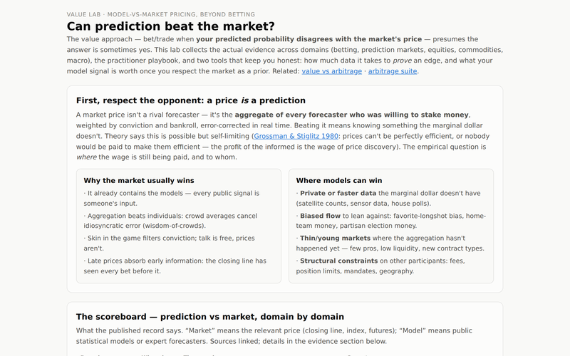
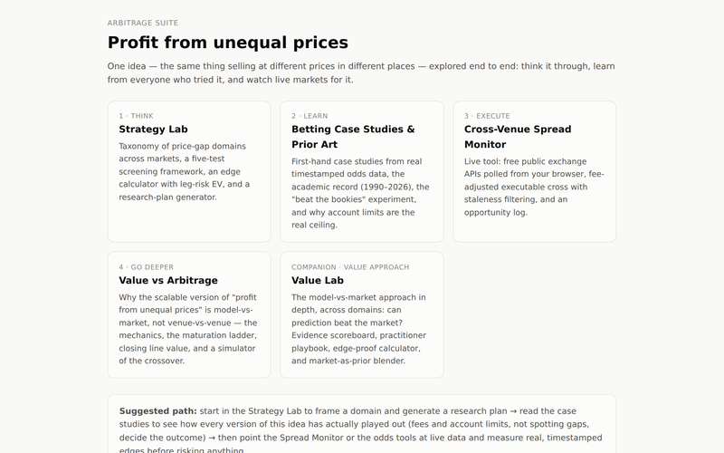
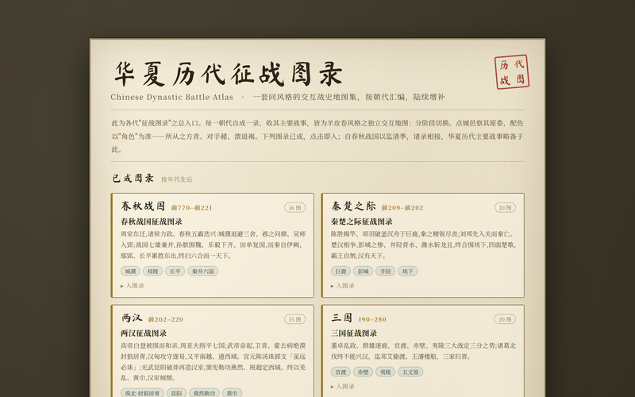
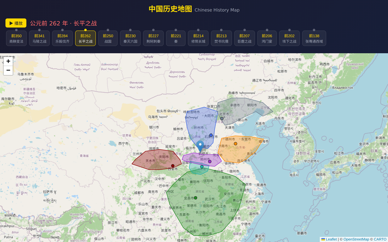

# Web Apps

A collection of small, focused web applications and tools.

**Live Site:** [https://ferryzhou.github.io/web-apps/](https://ferryzhou.github.io/web-apps/)

## Apps

<table>
  <tr>
    <td width="50%" valign="top">
      
      <h3><a href="https://ferryzhou.github.io/web-apps/ai-agents-in-practice/">AI Agents in Practice</a></h3>
      
Real stories of AI agents solving problems, shipping features, and moving metrics from 20 founders, engineering leaders, and hands-on developers. Each person's 2026 interviews are combined into one page with sources and learnings.

      
<code>AI</code> <code>Agents</code> <code>Interviews</code> · <a href="https://ferryzhou.github.io/web-apps/ai-agents-in-practice/">Live App</a> · <a href="ai-agents-in-practice/">Source</a>

    </td>
    <td width="50%" valign="top">
      
      <h3><a href="https://ferryzhou.github.io/web-apps/sc2-replay-player/">StarCraft II Replay Player</a></h3>
      
Drop a <code>.SC2Replay</code> file for a match summary, analytics dashboard (supply, income, army value, worker graphs, and build orders), and 2D minimap playback with a scrubber — decoded entirely in your browser.

      
<code>Gaming</code> <code>Client-side</code> <code>WASM</code> · <a href="https://ferryzhou.github.io/web-apps/sc2-replay-player/">Live App</a> · <a href="sc2-replay-player/">Source</a>

    </td>
  </tr>
  <tr>
    <td width="50%" valign="top">
      
      <h3><a href="https://ferryzhou.github.io/web-apps/world-cup-verdict/">The Verdict · World Cup Odds Accuracy</a></h3>
      
A cross-tournament study of how accurately pre-match betting odds predicted outcomes across eight FIFA World Cups (1998–2026, 496 matches) — accuracy, calibration, favourite bias, strategy lab, and per-edition studies.

      
<code>Sports</code> <code>Forecasting</code> <code>Data Viz</code> · <a href="https://ferryzhou.github.io/web-apps/world-cup-verdict/">Live App</a> · <a href="world-cup-verdict/">Source</a>

    </td>
    <td width="50%" valign="top">
      
      <h3><a href="https://ferryzhou.github.io/web-apps/value-lab/">Value Lab</a></h3>
      
Can prediction beat the market? The evidence across betting, prediction markets, equities, and commodities, the practitioner playbook (closing line value, Kelly, market-as-prior), and tools for proving an edge is skill rather than luck.

      
<code>Research</code> <code>Forecasting</code> <code>Interactive</code> · <a href="https://ferryzhou.github.io/web-apps/value-lab/">Live App</a> · <a href="value-lab/">Source</a>

    </td>
  </tr>
  <tr>
    <td width="50%" valign="top">
      
      <h3><a href="https://ferryzhou.github.io/web-apps/arbitrage/">Arbitrage Suite</a></h3>
      
Profit from unequal prices, end to end: a strategy lab (taxonomy, screening framework, edge calculator, plan generator), betting-market case studies with the full published record, and a live cross-venue spread monitor on free public APIs.

      
<code>Strategy</code> <code>Research</code> <code>Live Data</code> · <a href="https://ferryzhou.github.io/web-apps/arbitrage/">Live App</a> · <a href="arbitrage/">Source</a>

    </td>
    <td width="50%" valign="top">
      
      <h3><a href="https://ferryzhou.github.io/web-apps/christian-film-reviews/">光影与救赎 · 基督徒影评辑录</a></h3>
      
A curated anthology of Christian film criticism in Chinese — film readings by 王书亚（王怡）, 石衡潭, 刘小枫, and 齐宏伟, each with an original paraphrased summary, a typographic poster card, and a link to the source essay.

      
<code>Film</code> <code>Faith</code> <code>Anthology</code> · <a href="https://ferryzhou.github.io/web-apps/christian-film-reviews/">Live App</a> · <a href="christian-film-reviews/">Source</a>

    </td>
  </tr>
  <tr>
    <td width="50%" valign="top">
      
      <h3><a href="https://ferryzhou.github.io/web-apps/battle-atlas/">华夏历代征战图录 · Dynastic Battle Atlas</a></h3>
      
A unified portal to thirteen same-style interactive campaign atlases spanning Chinese history — Spring &amp; Autumn / Warring States through Qing (214 battles across 13 eras, 春秋 to 清).

      
<code>History</code> <code>Interactive</code> <code>Maps</code> · <a href="https://ferryzhou.github.io/web-apps/battle-atlas/">Live App</a> · <a href="battle-atlas/">Source</a>

    </td>
    <td width="50%" valign="top">
      
      <h3><a href="https://ferryzhou.github.io/web-apps/chinese-history-map/">Chinese Historical Map</a></h3>
      
Interactive timeline-based visualization of Chinese dynasties and kingdoms with detailed historical information, key events, and notable figures.

      
<code>History</code> <code>Interactive</code> <code>Map</code> · <a href="https://ferryzhou.github.io/web-apps/chinese-history-map/">Live App</a> · <a href="chinese-history-map/">Source</a>

    </td>
  </tr>
</table>

## Development

This repo is designed for AI-assisted development with async coding agents. Each app is a self-contained HTML+JavaScript tool that can be built quickly and reviewed from anywhere (including mobile).

See [CLAUDE.md](CLAUDE.md) for development guidelines.

## License

MIT
